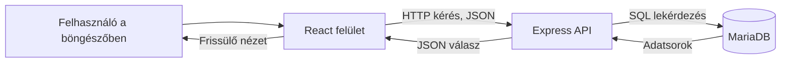

# Az EventFlow projekt működése

Ez az útmutató a projekt forráskódját magyarázza el a felhasználói működéstől az adatbázisig. A példák a jelenlegi React, Express és MariaDB alapú megvalósítást követik.

## Mire való az alkalmazás?

Az EventFlow egy konferencia vagy más esemény programjának összeállítását és böngészését támogatja. A szervező előadásokat helyez el a naptárban, termet és előadót rendel hozzájuk. A látogató megkeresi az őt érdeklő programokat, majd személyes programot állít össze belőlük.

Az esemény a teljes rendezvény, például egy konferencia. Az előadás ennek egy programpontja, például egy nyitóelőadás vagy workshop. Egy előadó több programpontot is tarthat, és egy teremben több, különböző időpontú előadás szerepelhet.

A látogatói mentés azt rögzíti, hogy a felhasználó szeretne részt venni egy előadáson. Jegyértékesítés és ülőhely-kiosztás nincs beépítve, a terem kapacitása nem csökken a mentések számával.

## A rendszer három része

| Rész | Feladata | Fő technológia |
| --- | --- | --- |
| Frontend | Megjelenítés, űrlapok, naptár, szűrés és a felhasználó műveletei | React, TypeScript, Vite, CSS Modules |
| Backend | HTTP kérések, jogosultságok, ellenőrzések és adatbázis-műveletek | Node.js, Express, TypeScript |
| Adatbázis | Előadások, előadók, felhasználók, mentések és naplóbejegyzések tárolása | MariaDB |



A böngésző a backend API-ját hívja. A MariaDB jelszavát és a JWT aláírásához használt titkot a szerver kezeli.

Dockerben az Express a lefordított frontendet is kiszolgálja, ezért a teljes alkalmazás a `http://localhost:3000` címen érhető el. Fejlesztéskor a Vite külön folyamatban fut, általában az 5173-as porton.

## Hol találhatók a fontos fájlok?

| Fájl vagy mappa | Mit érdemes itt keresni? |
| --- | --- |
| `index.html` | A böngészőbe betöltött alap HTML és a React számára fenntartott `root` elem |
| `src/frontend/main.tsx` | A frontend indítása és a globális szolgáltatók bekötése |
| `src/frontend/Root.tsx` | Bejelentkezés, adatbetöltés, fő alkalmazásállapot, szerepkör szerinti nézetválasztás |
| `src/frontend/App.tsx` | A szervező felülete és navigációja |
| `src/frontend/components/` | A kezdőlap, bejelentkezés, naptárak, listák, űrlapok és részletező ablakok |
| `src/frontend/components/admin/` | Az adminisztrátori felület és annak aloldalai |
| `src/frontend/lib/` | API-hívások, adatátalakítás, foglalási szabályok, ICS export és értesítések |
| `src/frontend/i18n/` | A magyar, angol és német feliratok és dátumformázás |
| `src/frontend/theme/` | A világos és sötét megjelenés állapota |
| `src/frontend/global.css` | Globális alapstílusok és témaváltozók |
| `src/frontend/styles/` | Több komponens által használt CSS-alapok |
| `src/backend/server.ts` | Express alkalmazás, végpontok, adatbázis-kapcsolat és szerverindítás |
| `src/backend/types.ts` | A frontend és backend által közösen használt TypeScript típusok |
| `src/backend/auth.ts` | JWT kiállítása, ellenőrzése és jogosultságellenőrző middleware-ek |
| `src/backend/sessionConflicts.ts` | A szerveroldali terem- és előadóütközések ellenőrzése |
| `src/backend/sessionSpeaker.ts` | Létező előadó kiválasztásának ellenőrzése |
| `src/backend/passwordReset.ts` | A helyi fejlesztői jelszó-visszaállítás folyamata |
| `src/backend/dbSchema.ts` | A meglévő adatbázis indításkori bővítései |
| `src/backend/eventflow.sql` | Az alapadatbázis sémája és kezdeti bemutatóadatai |
| `src/backend/demoSeed.ts` | Újra felhasználható demóadat-betöltés |
| `tests/workflows.test.mjs` | Felületi működéshez és segédfüggvényekhez kapcsolódó regressziós tesztek |
| `Dockerfile`, `compose.yaml` | Az alkalmazás és kapcsolódó szolgáltatások Docker-beállításai |

## A frontend kódjának alapfogalmai

| Fogalom | Mit jelent ebben a projektben? |
| --- | --- |
| Komponens | Egy felületi egységet leíró függvény, például a `LoginPage` vagy a `CalendarView`. JSX-elemeket ad vissza, amelyekből a React elkészíti a megjelenítést. |
| Props | A szülő komponens által átadott adatok és műveletek. A kezdőlap például az `onSignIn` függvényt a `Root` komponenstől kapja. |
| `useState` | A komponens változó állapotát tárolja. A módosító függvény hívása után a React frissíti az érintett megjelenítést. |
| `useEffect` | A megjelenítéshez kapcsolódó külső műveletet indít, például adatlekérést vagy időzítőt. Az időzítőket a takarító függvény leállítja. |
| `useCallback` | A megadott függvényt a függőségei változásáig megtartja. A `Root` adatlekérő függvényei így használhatók az effectek függőségeiként. |
| Context és provider | Több komponensnek ad közös adatokat. A nyelvet az `I18nProvider`, a megjelenési témát a `ThemeProvider` biztosítja. |
| `async` és `await` | A hálózati válaszra váró műveletek olvasható leírása. A `try/catch` a sikertelen kérésből származó hibát kezeli. |
| DTO és TypeScript-típus | Az API-n átadott adat alakját írja le. Az űrlap állapota és az adatbázisba küldött kérés külön alakot is használhat. |

## Mi történik az oldal megnyitásakor?

1. A böngésző betölti az `index.html` fájlt és a frontend JavaScript-kódját.
2. A `main.tsx` meghívja az `initializeTheme()` függvényt, majd elindítja a React alkalmazást.
3. A `ThemeProvider` és az `I18nProvider` elérhetővé teszi a témát és a nyelvet a komponensekben.
4. A `Root` beolvassa a böngészőben tárolt korábbi bejelentkezést.
5. A `GET /api/health` hívással ellenőrzi a backend és az adatbázis elérhetőségét. A hívásnak két másodperces időkorlátja van.
6. Elérhető backend esetén lekéri az előadásokat, a termeket és az aktív esemény profilját. A korábbi JWT-t a `/api/auth/me` végponton ellenőrzi.
7. Elérhetetlen backend esetén beépített demóadatokat használ.
8. A felhasználó szerepköre és az aktuális nézetállapot alapján megjelenik a megfelelő felület.

A fő nézetváltást a `Root.tsx` React-állapota kezeli. A névtelen látogató állapotai `landing`, `login`, `reset` és `program`. Bejelentkezett adminnál az `AdminApp`, szervezőnél az `App`, látogatónál a `PublicEventsPage` jelenik meg.

A nézetváltás jelenleg nem külön URL-ekre épül. Az oldal újratöltése a kezdő nézetet állítja vissza, a böngészőben elmentett érvényes bejelentkezést azonban újra betölti.

## Hogyan épül fel a marketingkezdőlap?

A `LandingPage.tsx` bemutatja az EventFlow előnyeit, a programkezelés funkcióit, a használat lépéseit és a négy szerepkört. A fejléc hivatkozásai ugyanazon az oldalon a funkciókhoz, a használat bemutatásához és a gyakori kérdésekhez visznek. A lenyitható kérdések a böngésző saját `details` és `summary` elemeivel működnek.

A programfelfedező gomb az `onBrowseProgram` függvényen keresztül a vendégprogramot nyitja meg. A bejelentkezési gomb az `onSignIn` függvényt hívja. A tényleges nézetváltás mindkét esetben a `Root` feladata.

A kezdőlapi programkártya szemléltető minta, amelynek időpontjai a komponens `previewSessions` tömbjében vannak. A tényleges, adatbázisból érkező program a gomb megnyomása után jelenik meg a `PublicEventsPage` felületén.

A marketinges szövegek a `translations.ts` `landing` objektumaiban találhatók mindhárom nyelvnél. Az elrendezésért a `landingPage.module.css` felel. A kezdőlap a közös témaszíneket, logót, betűtípusokat és a bejelentkezési oldalon is szereplő konferenciatermi fényképet használja.

## Ki mit csinálhat?

| Szerepkör | Belépés utáni felület | Jellemző műveletek |
| --- | --- | --- |
| Vendég | Nyilvános program | Előadások és előadók böngészése, keresés és szűrés |
| Látogató, `attendee` | Nyilvános program személyes funkciókkal | Saját program mentése, eltávolítás, export és értesítések |
| Szervező, `booker` | Szervezői programkezelés | Előadások létrehozása, szerkesztése, másolása és lemondása |
| Admin, `admin` | Adminisztrátori irányítópult | Program, felhasználók, szerepkörök, előadók, teremhozzárendelések, eseményprofil és napló |

Az új regisztráció az adatbázis alapértelmezése szerint látogatói fiókot hoz létre. A szerepkört az admin módosíthatja.

Az admin termeket rendelhet egy szervezőhöz. Foglaláskor a backend az aktuális adatbázis-hozzárendeléseket is ellenőrzi. A jelenlegi szabály szerint az üres teremlista minden terem használatát engedélyezi. A demó szervezőhöz az első két terem tartozik.

## A nyilvános program és a személyes program

A `PublicEventsPage.tsx` kezeli az összes program, a mentett program és az előadók füleit. Vendégként a mentett program fül nem jelenik meg. A lista-, napirend- és naptárnézet ugyanazokból az előadásokból dolgozik.

A keresés az előadás címét, az előadót és a termet veszi figyelembe. A szűrők a megjelenített listát szűkítik, az adatbázis tartalmát nem módosítják.

Egy előadásra kattintva megnyílik az `AttendeeDetailModal`. A mentés és eltávolítás innen indítható, ezért minden nézetből ugyanaz a részletező és művelet érhető el.

Mentéskor a folyamat a következő.

1. A felület ellenőrzi a személyes programmal való időbeli átfedést.
2. Ütközés esetén megerősítő ablak jelenik meg. A látogató dönthet az átfedő előadás mentéséről.
3. A `Root.handleSaveSession()` meghívja a `scheduleApi.ts` megfelelő függvényét.
4. A backend a JWT alapján azonosítja a látogatót, majd hozzáadja az előadást a `user_schedule` táblához.
5. A frontend frissíti a mentett előadások állapotát.

Az adatbázis egyedi kulcsa és az `INSERT IGNORE` megakadályozza ugyanannak a felhasználó–előadás párnak a többszörös tárolását. Eltávolításkor csak a személyes mentés szűnik meg, maga az előadás megmarad.

A lemondott előadás jelölést kap. A felületen új mentés helyett a lemondásról szóló tájékoztatás jelenik meg, egy korábbi mentés pedig továbbra is eltávolítható.

## Hogyan szervezhető a program?

A `SessionWorkspace.tsx` a szervező és az admin közös programkezelője. Kezeli a nézetváltást, keresést, terem- és előadószűrőket, az aktuális részletezőt és a foglalási ablak állapotát.

Új előadás a naptár egyik napjára kattintva hozható létre. A kiválasztott nap bekerül a kezdő és záró dátum mezőjébe. A `BookingModal.tsx` bekéri a címet, leírást, kezdést, befejezést, termet, előadót és színt.

A keynote, panel és workshop sablonok címet, időtartamot és színt állítanak be. Az előadó mindig a katalógusból választható. Új előadót az admin Előadók nézetében kell felvenni.

A `DetailModal.tsx` tartalmazza a szerkesztés, másolás, lemondás, visszaállítás és törlés műveleteit. Másoláskor az eredeti előadásból előtöltött űrlap nyílik meg, és mentéskor új rekord keletkezik.

A lemondás a `status` értékét `cancelled` állapotra állítja, az előadást megőrzi. A törlés eltávolítja a rekordot, és az adatbázis kapcsolatai miatt a hozzá tartozó látogatói mentések is törlődnek.

## A dátumok és ütközések szabályai

Az adatbázis a kezdést és befejezést teljes `DATETIME` értékként tárolja. A felület külön dátum- és időmezőkkel dolgozik. A `bookingFormToApiBody()` ezeket alakítja át például `2026-03-20 09:00:00` formára.

A `sessionFormat.ts`, a `sessionBooking.ts` és a backend `datetime.ts` segít egységesen kezelni a dátumokat, időket és az API-ból érkező különböző formátumokat.

A többnapos előadás egyetlen folytonos időintervallum. A március 20. 10 órától március 22. 18 óráig tartó előadás éjszaka is a teljes intervallum része. Nincs benne automatikusan ismétlődő napi 10–18 órás szakasz.

| Ellenőrzés | Jelenlegi szabály |
| --- | --- |
| Érvényes időtartam | A befejezés a kezdés után legyen |
| Azonos terem | Két aktív előadás nem fedheti egymást |
| Terem előkészítése | Két foglalás között legalább két óra különbség kell |
| Azonos előadó | Két aktív előadása nem fedheti egymást |
| Lemondott előadás | A részletes ütközésellenőrzés kihagyja |
| Személyes program | Az időbeli átfedés megerősíthető figyelmeztetés |

Például egy 10 órakor végződő előadás után ugyanabban a teremben 11.30-as kezdés ütközést jelent, a 12.00-s kezdés már megengedett. Külön termek között ez a kétórás szabály nem alkalmazandó, az előadó időbeli ütközése azonban továbbra is számít.

Az űrlap előzetes visszajelzést ad a `src/frontend/lib/sessionBooking.ts` alapján. Egyedi létrehozás és szerkesztés esetén a backend is ellenőrzi a szabályokat a `src/backend/sessionConflicts.ts` segítségével.

## Mit mutat az adminisztrátori felület?

Az `AdminApp.tsx` oldalsávja külön nézetet biztosít az áttekintéshez, a felhasználókhoz, a programhoz, a teremhasználathoz, az előadókhoz, az auditnaplóhoz és az eseményprofilhoz.

A felhasználói nézetben szerepkör állítható, fiók törölhető és szervezőhöz terem rendelhető. A szervezői áttekintés és az admin áttekintése összesítéseket ad az előadásokról, termekről és előadókról. Ezek az alkalmazás saját adataiból számított értékek.

Az előadók nézetében név és bemutatkozás tárolható. Duplikátumok egyesítésekor a backend a megszüntetendő előadók előadásait a megtartott azonosítóhoz rendeli, majd eltávolítja a duplikátumokat. Ha a megtartott előadónál üres a bemutatkozás, egy másik rekordból átveheti azt.

Az auditnapló tárolja például az előadás létrehozását, szerkesztését, lemondását, a szerepkörváltást és az előadó-egyesítést. A bejegyzés tartalmaz művelettípust, felhasználót, érintett rekordot, időpontot és további részleteket.

Az eseményprofil szerkesztőjében a rendezvény neve, helyszíne, dátumai és leírása módosítható. A nyilvános program ezeket használja a rendezvény bemutatásakor és a visszaszámlálónál.

## Az adatbázis táblái és kapcsolatai

| Tábla | Lényeges tartalom | Kapcsolat |
| --- | --- | --- |
| `users` | Név, e-mail, jelszóhash, szerepkör, `auth_version` | Mentések, teremhozzárendelések és jelszó-visszaállítás |
| `rooms` | Teremnév és kapacitás | Egy teremhez több előadás tartozhat |
| `speakers` | Előadónév és bemutatkozás | Egy előadóhoz több előadás tartozhat |
| `sessions` | Cím, leírás, kezdés, befejezés, terem, előadó, szín, állapot | Hivatkozik a teremre és az előadóra |
| `user_schedule` | `user_id`, `session_id`, mentési idő | Több-a-többhöz kapcsolat látogatók és előadások között |
| `user_rooms` | `user_id`, `room_id` | A szervező számára engedélyezett termek kapcsolótáblája |
| `events` | Az esemény neve, helyszíne, dátumai és aktív állapota | A jelenlegi felület egy aktív esemény profilját használja |
| `activity_log` | Ki, mit, melyik rekorddal és mikor tett | Alkalmazási műveletek története |
| `password_reset_tokens` | Kód vagy egyszeri bizonyíték hash-e, lejárat, lépés és próbálkozásszám | Felhasználónként egy visszaállítási folyamat |

A `user_schedule` kapcsolótábla teszi lehetővé, hogy egy látogató több előadást mentsen, és egy előadást több látogató válasszon. A felhasználó vagy az előadás törlésekor a kapcsolódó mentéseket az idegen kulcsok `ON DELETE CASCADE` szabálya eltávolítja.

A `sessions.room_id` és `sessions.speaker_id` kapcsolata `ON DELETE SET NULL` szabályú. Egy előadó törlése így nem törli az előadásokat, az érintett hivatkozás üressé válik. Az alkalmazás az új foglalásoknál létező előadót kér.

Az `eventflow.sql` adja az alapot. Induláskor a `dbSchema.ts` szükség szerint hozzáad például állapotoszlopot és kiegészítő táblákat. A jelszó-visszaállítás saját sémabővítése a `passwordReset.ts` része.

## A közös típusok szerepe

A `src/backend/types.ts` fájlt a frontend is importálja. A `Session` egy megjeleníthető előadást ír le, a `User` a biztonságosan továbbadható felhasználói adatokat, a `BookingFormData` az űrlap állapotát.

A `CreateSessionBody` az előadásmentéshez elküldött adatokat, az `EventProfile` az eseményprofilt, a `SessionSavesMap` pedig az előadásonként mentő látogatókat írja le.

A TypeScript ezeket fejlesztés és build közben ellenőrzi. A böngészőből érkező HTTP-adatokat a backendnek futásidőben is ellenőriznie kell, mert a külső kérések nem kötelesek a TypeScript-típusoknak megfelelni.

## API-hívások és hibakezelés

Az `api.ts` az `apiUrl()` függvénnyel állítja elő a végpont címét. Alapértelmezésben relatív `/api/...` útvonalakat használ. Fejlesztéskor a `vite.config.ts` proxyzza ezeket a 3000-es portra, Dockerben ugyanaz az Express szolgálja ki az API-t és az oldalt.

Az `authFetch.ts` a védett kérésekhez hozzáadja az `Authorization: Bearer ...` fejlécet. Az `authRequest()` és az `ensureResponseOk()` a sikertelen HTTP-válaszból hibát készít. A felület ezt lefordított üzenetként jelenítheti meg.

| Végpont | Hozzáférés és feladat |
| --- | --- |
| `GET /api/health` | Nyilvános állapot és adatbázis-elérhetőség |
| `GET /api/event`, `/api/rooms`, `/api/sessions` | Nyilvános eseményprofil, teremlista és program |
| `POST /api/auth/register`, `/api/auth/login` | Regisztráció és bejelentkezés |
| `GET /api/auth/me` | JWT alapján az aktuális felhasználó |
| `GET /api/my-schedule` | Látogató saját mentései |
| `POST`, `DELETE /api/my-schedule/:sessionId` | Saját program hozzáadása és eltávolítása |
| `POST /api/sessions` | Szervező vagy admin új előadást készít |
| `PATCH`, `DELETE /api/sessions/:id` | Egy előadás módosítása vagy törlése |
| `PATCH /api/sessions/:id/status` | Lemondás vagy visszaállítás |
| `PATCH /api/sessions/bulk` | Kijelölt előadások dátumának és termének tömeges módosítására szolgáló végpont |
| `GET /api/sessions/saves` | Szervező és admin előadásonként láthatja a mentő látogatókat |
| `GET /api/speakers` | Szervező és admin előadókatalógusa |
| `POST /api/speakers`, `PATCH`, `DELETE /api/speakers/:id` | Admin előadókezelése |
| `POST /api/speakers/merge` | Admin duplikált előadókat egyesít |
| `GET /api/admin/users`, `PATCH`, `DELETE /api/admin/users/:id` | Admin felhasználókezelése |
| `PUT /api/admin/users/:id/rooms` | Admin szervezőhöz rendel termeket |
| `GET /api/admin/activity-log` | Admin műveleti naplója |
| `PATCH /api/admin/event` | Admin eseményprofilt módosít |
| `POST /api/admin/seed-demo` | Admin bemutatóadatokat tölt be |

A `400` hibás adatot, a `401` hiányzó vagy érvénytelen bejelentkezést, a `403` elégtelen jogosultságot, a `404` hiányzó rekordot, a `409` ütközést jelez. A `429` a kéréskorlát elérésére, az `500` szerverhibára utal.

## Bejelentkezés és jogosultságok

A regisztrációkor a backend a jelszóból `bcrypt` hash-t készít, ezt menti a `users.password_hash` mezőbe. Bejelentkezéskor a `bcrypt.compare()` ellenőrzi a megadott jelszót.

Sikeres belépéskor a backend egy biztonságos felhasználói objektumot és egy aláírt JWT-t küld vissza. Az `authStorage.ts` a profilt és a tokent a böngésző `localStorage` tárhelyére menti.

A védett végpontok `authenticate` middleware-e ellenőrzi a token aláírását és lejáratát, majd betölti az aktuális felhasználót az adatbázisból. A jogosultságvizsgálat az adatbázis aktuális szerepkörét használja.

A `requireAdmin`, `requireRoles('booker', 'admin')` és `requireRoles('attendee')` meghatározza, melyik végpontot melyik szerepkör hívhatja. A menüpontok elrejtése mellett tehát a szerver is érvényesíti a szerepkörök alapvető hozzáférési szabályait.

A JWT a felhasználó `auth_version` értékét is hordozza. Jelszó-visszaállítás után ez az érték nő, és a korábban kiállított tokenek érvénytelenné válnak. Kijelentkezéskor a frontend törli a helyben tárolt profilt és tokent.

## A jelszó-visszaállítás folyamata

A jelenlegi megvalósítás kifejezetten helyi fejlesztői kipróbálásra készült. Az `npm run server:local` beállítja a `NODE_ENV=development` és `PASSWORD_RESET_DELIVERY=console` értékeket. A `CLIENT_URL` helyi cím kell legyen.

1. A `/api/auth/password-reset/request` e-mail-cím alapján kér egy hatjegyű kódot.
2. A fejlesztői frontend a választ a böngésző fejlesztői konzoljába írja.
3. A `/verify` a helyes kódból egyszer használható visszaállítási tokent készít.
4. A `/confirm` ezt a tokent és az új jelszót ellenőrzi, majd módosítja a jelszóhash-t.

A kód 15 percig érvényes, új kód legfeljebb percenként kérhető. Öt hibás kódpróba után új kód szükséges. Az új jelszó legalább nyolc Unicode-karakter és legfeljebb 72 UTF-8 bájt lehet. A regisztráció saját ellenőrzése ettől külön kódút.

Az adatbázis a kód és a token hash-ét tárolja. A megerősítés tranzakcióban módosítja a jelszót, érvényteleníti a régi munkameneteket és elfogyasztja a visszaállítási lehetőséget. Az API a kérések számát IP-címenként is korlátozza.

A Dockerfile `production` módban indít. Ebben a módban a konzolos kódkiadás letiltott, a visszaállítási API nem érhető el működő kódküldésként. E-mail-küldő szolgáltatás a projektben nincs bekötve.

## Naptárexport és emlékeztetők

Az `icsExport.ts` `.ics` fájlt készít az exportálandó előadásokból. A fájlban szerepel a cím, kezdés, befejezés, terem, előadó és leírás. A böngésző ezt fájlként letölti, majd naptáralkalmazásba importálható.

Az export pillanatfelvétel. Egy később módosított előadás a korábban letöltött fájlban nem frissül automatikusan. Az export a felületen aktuálisan kiválasztott és szűrt programlistából indul.

Az emlékeztetőket a `sessionNotifications.ts` kezeli. A felhasználó engedélyével a böngésző Notification API-ján keresztül jelez az előadás kezdete előtt 15 perccel. Percenként ellenőrzi az időpontokat, és helyben tárolja, melyik értesítés jelent már meg.

Az értesítésekhez futó oldal és támogatott, engedélyezett böngészőértesítés szükséges. A rendszernek nincs háttérben futó mobilalkalmazása vagy szerveres push értesítési szolgáltatása.

## Frissülő adatok, demó és tárolás

Bejelentkezett, backendhez kapcsolódó használatkor a `Root` ötmásodpercenként lekéri az előadásokat és a szerepkörhöz tartozó programadatokat. Ez időzített HTTP-lekérés, azaz polling. Vendégnézetben nincs ugyanez az időzített frissítés.

A komponensek saját rövid életű állapotot tartanak, például keresőkifejezést, nyitott ablakot vagy kijelölt előadásokat. A `Root` kezeli a több nézet számára közös adatokat.

| Tárolás | Példák | Meddig marad meg? |
| --- | --- | --- |
| React-állapot | Aktív nézet, megnyitott ablak, szerkesztett űrlap | Az oldal újratöltéséig vagy a komponens megszűnéséig |
| Böngésző `localStorage` | Bejelentkezés, nyelv, téma, offline mentések és értesítési állapot | Ugyanabban a böngészőben, amíg a felhasználó vagy alkalmazás törli |
| MariaDB | Előadások, felhasználók, programmentések, napló | Tartósan, Dockerben a `demo-db` kötetben |

Ha a backend induláskor nem érhető el, a felület a `Root.tsx` és a `demoUsers.ts` beépített adataival működik. Ilyenkor a látogató mentései helyben tárolódnak. A szervezői előadásmódosítások React-állapotban történnek, újratöltéskor elvesznek. Regisztrációhoz, valódi admin API-műveletekhez és adatbázisos naplóhoz backend szükséges.

A Dockeres bemutató tényleges MariaDB-t használ. A `demoSeed.ts` a demófiókokat, termeket és előadókat frissítheti, ezért a demóbetöltés nem pusztán olvasási művelet. A meglévő érvényes előadásokat alapértelmezésben megőrzi, a kényszerített betöltés lecseréli őket.

## Nyelvek, témák és CSS

A `translations.ts` tartalmazza a magyar, angol és német feliratokat. A komponensek például a `t('login.signIn')` hívással kérik a megfelelő szöveget. A `{{count}}` jellegű változók futásidőben kapnak értéket.

Az `I18nProvider` tárolja a kiválasztott nyelvet, beállítja a dokumentum nyelvét és biztosítja a `useI18n()` hookot. A dátumformázó segédfüggvények a magyar, brit angol és német dátumformátumot használják. A nyelvválasztás megmarad a böngészőben.

A `ThemeProvider` a világos és sötét témát kezeli. A `global.css` színváltozói a dokumentum `data-theme` attribútumát követik. Például a `var(--surface)` és a `var(--primary)` ugyanabban a komponensben mindkét témához illő színt ad.

A komponens melletti `*.module.css` fájl osztályai helyileg érvényesek. A Vite egyedi osztályneveket készít belőlük. A közös `styles/` alapok a CSS Modules `composes` megoldásával vehetők át. Ezért egyetlen ablak szélességét a saját moduljában, az egész alkalmazás színeit pedig a globális témaváltozóknál érdemes módosítani.

## Indítás Dockerrel

A parancsokat az alkalmazás forrásmappájában kell futtatni, ahol a `compose.yaml` található. Ezen a gépen ez a `/Users/kovad16/eventflow` mappa. A `Documents/ChatGPT/eventflow` külön prezentációs mappa.

```bash
cd /Users/kovad16/eventflow
docker compose up --build --wait
```

A Docker Desktopnak futnia kell. Az első buildhez az alapimage és csomagok letöltése miatt internetkapcsolat szükséges. A Compose elindítja a MariaDB-t, megvárja annak egészséges állapotát, majd elindítja az alkalmazást és a phpMyAdmin felületét.

| Szolgáltatás | Helyi cím és szerep |
| --- | --- |
| `app` | `http://localhost:3000`, frontend és backend |
| `db` | MariaDB a Docker-hálózaton belül, az alkalmazás `db` gépnévvel éri el |
| `phpmyadmin` | `http://localhost:8080`, az adatbázis grafikus kezelője |

A demófiókok `admin@example.com`, `booker@example.com` és `attendee@example.com`, a bemutatóban mindháromhoz az `admin` jelszó tartozik. Ezek a projekt dokumentált helyi bemutatóadatai.

Az SQL-import a MariaDB adatkönyvtárának első létrehozásakor fut le. A `demo-db` névvel ellátott kötet tartósan megőrzi az adatokat, így az újraindítás és az app újraépítése nem inicializálja újra az adatbázist.

```bash
docker compose ps
docker compose logs --tail=80 app
curl http://localhost:3000/api/health
docker compose stop
docker compose start --wait
```

A `stop` leállít, a `start` a már létező konténereket indítja. Forráskód-módosítás után a `docker compose up --build --wait` szükséges. A Dockerfile bemásolja a forrást és elkészíti a `dist/` könyvtárat, a futó konténer ezért a buildkori állapotot használja.

A `dist/` a lefordított frontend. Kézi szerkesztése helyett a `src/` fájlokat kell módosítani és új buildet készíteni.

## Fejlesztés Vite-tal

Gyors felületi szerkesztéshez a Vite automatikus frissítést ad. A backend és a frontend külön terminálban fut.

```bash
cd /Users/kovad16/eventflow
npm install
```

Az első helyi beállításkor az `.env.example` alapján létre kell hozni a saját `.env` fájlt, és beállítani a MariaDB-kapcsolatot. Meglévő `.env` esetén a saját beállításokat kell használni.

```bash
npm run server:local
```

```bash
npm run dev
```

A `server:local` a helyi jelszó-visszaállítást is engedélyezi. Az `npm run server` a normál backendparancs. A helyi adatbázis alapstruktúráját az `eventflow.sql` adja, a kapcsolódó kiegészítéseket a szerver indításkor hozza létre.

A Docker app és egy helyi backend alapértelmezésben ugyanazt a 3000-es portot szeretné használni. A Vite felület önmagában használhatja a már futó Docker backendjét, de a Docker production módjában a konzolos jelszó-visszaállítás letiltva marad.

## Hogyan ellenőrizhető egy változtatás?

```bash
npm run build
npm run lint
npm test
```

A build a TypeScript-ellenőrzést és a frontend fordítását végzi. A projektben a nem használt aktív változók is fordítási hibát okozhatnak. Ha egy JSX-részletet kikommentezel, a kizárólag ott használt adatokat is ki kell venni az aktív kódból.

A lint a kódminőségi és React hook szabályokat vizsgálja. A tesztek a terem- és előadóütközéseket, dátumformázást, előadóválasztást, jelszó-visszaállítást és a fontos felületi szerződéseket ellenőrzik.

A `tests/workflows.test.mjs` több felületi elemet renderelt kimeneten vizsgál. A tesztek mellett böngészőben is érdemes végigmenni a módosított folyamaton, különösen mobilméretben, más nyelven és sötét témában.

## Gyakori módosítások helye

| Változtatás | Érintett terület |
| --- | --- |
| Marketingkezdőlap elrendezése | `components/LandingPage.tsx` és `components/landingPage.module.css` |
| Kezdőlapi szövegek | `i18n/translations.ts`, a `landing` kulcsok mindhárom nyelvnél |
| Bejelentkezési űrlap | `components/LoginPage.tsx` és saját CSS-modulja |
| Új előadásmező | SQL-séma, `types.ts`, backend végpont, API-átalakítás és a foglalási űrlap |
| Foglalási szabály | Frontend `lib/sessionBooking.ts` és backend `sessionConflicts.ts` |
| Új adminfunkció | `components/admin/`, kapcsolódó API és backend jogosultságellenőrzés |
| Alapszínek, sötét téma | `global.css` és a helyi modulok témaváltozói |
| Demóprogram | `backend/demoSeed.ts`, első SQL-import és külön az offline `Root.tsx` mintaadatai |

Új API-mezőnél végig kell követni az adat útját. Például egy előadás új kategóriája tárolást, API-választ, TypeScript-típust, űrlapmezőt és megjelenítést is érinthet. A csak felületi szűréshez ezzel szemben elegendő lehet a már betöltött adatok feldolgozása.

## A jelenlegi megvalósítás határai

A forrás egy aktív esemény bemutatására épül. Az `events` táblában és a `sessions.event_id` mezőben van előkészítés több eseményre, de a nyilvános előadáslista jelenleg nem választ esemény szerint. Több külön rendezvény teljes elkülönített kezelése további munkát igényel.

A látogatói mentés, a teremfoglalás és a naptárexport három külön művelet. A mentésszám megmutatja az érdeklődőket, a foglalás a program időbeosztását írja le, az ICS pedig letölthető másolatot készít.

A tömeges módosításnak van felülete és API-kódja. A vizsgált forrásban a `PATCH /api/sessions/:id` útvonal a `/api/sessions/bulk` előtt szerepel, ezért a `bulk` kérést az egyedi szerkesztő kezelheti. A tömeges handler jelenleg nem hívja meg az egyedi mentés ütközésellenőrzését. Ennek használatát külön integrációs ellenőrzéssel kell igazolni.

Az egyedi szerkesztés, létrehozás és a speciális műveletek eltérő handlerben vannak. Például a visszaállítás és az előadó-egyesítés nem futtatja automatikusan újra a teljes foglalási ütközésellenőrzést. A program szabályainak módosításakor ezeket az útvonalakat is figyelembe kell venni.

A frontend `hasRoomConflict()` előzetes mentési ellenőrzése jelenleg a lemondott előadásokat is figyelembe veszi, miközben a részletes előnézet és a backend kihagyja őket. Emiatt a felületi mentés olyan esetben is foglaltnak jelezhet egy termet, amelyet a szerver már felszabadultnak tekint. A teremhozzárendelés ellenőrzése sem azonos minden műveletben, a lemondás, visszaállítás és törlés saját handlerét külön kell vizsgálni.

A projekt helyi bemutatócsomagjában a Docker portok a saját gép `127.0.0.1` címére vannak kötve. A dokumentált címek erről a gépről érhetők el. A nyelvválasztás megmarad, a Google Fonts betűtípusai viszont internetkapcsolat nélkül a CSS-ben megadott tartalék betűtípusokra válthatnak.

## Egy rövid bemutató menete

Nyisd meg a kezdőlapot, mutasd meg a nyelv- és témaváltást, majd vendégként a programot. Jelentkezz be látogatóként, ments el egy előadást, és mutasd meg a saját programot és az exportot.

Lépj be szervezőként, a naptárban keresd meg a 2026. márciusi mintaidőszakot, majd egy szabad napon hozz létre előadást egy engedélyezett teremben és létező előadóval. Mutasd meg a részleteket, szerkesztést és lemondást.

Adminisztrátorként mutasd meg az előadókatalógust, a felhasználói szerepköröket, a teremhozzárendelést, az eseményprofilt és a műveleti naplót. A projekt felépítését a `main.tsx → Root.tsx → nézet → API → MariaDB` adatút alapján lehet végigvezetni.
